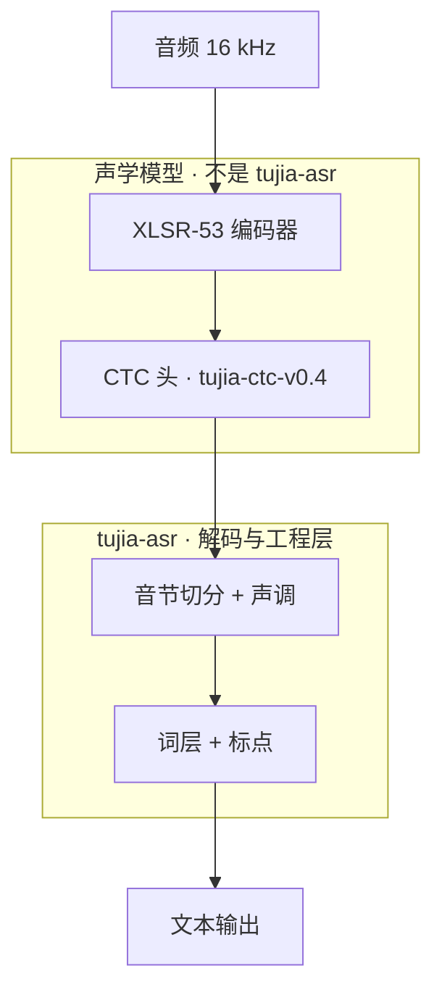
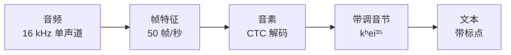

# 把土家语的声音，变成可以校对的文字

> 技术与使用说明 · 2026-11
> 面向：技术 / 非技术 / 语言学 / 土家语爱好者 / AI 爱好者
> 版本：tujia-asr 1.1.0 · tujia-ctc v0.4（下文 v0.3 的对比保留为背景）

先给结论：**tujia-asr 不是一个语音模型，而是一套把「语音模型输出」加工成可用文本的工程管线。** 其中负责「听音」的部分是一个 CTC 模型，它只占整套系统的三分之一；剩下三分之二——音节怎么切、声调怎么定、哪些词敢给释义、句子在哪里断——全部由规则和解码完成。

> **v0.4 速览**：输出头改为 932 个去调音节 + 独立四调头；在 840 条田野测试集上音节 SER 0.2132、调 SER 0.2054、联合带调 SER 0.3543。测试按词条划分、说话人在训练集中出现过，因此这不是“未见说话人”分数。

| 指标 | 数值 | 含义 |
|---|---|---|
| 932 + 4 | 932 个去调音节类别，外加 4 个调类（独立的调头） |
| 0.213 | v0.4 田野测试集上的音节错误率（SER），越低越好 |
| 4 | 模型区分的调值：21 / 35 / 53 / 55 |

---

## 01 读者地图

| 你是谁 | 建议读 | 你会得到 |
|---|---|---|
| 不懂技术，但关心这件事能不能用 | 01、02、08、09 | 它解决什么问题、可靠到什么程度、哪里会出错 |
| 语言学者 / 记音工作者 | 03、07、10、11 | 声调怎么表示、音节切分依据、词典口径与借用标注 |
| 土家语爱好者 / 学习者 | 02、05、08、11 | 为什么它给不出「标准答案」，以及怎样把它当校对助手 |
| AI / 语音方向从业者 | 04、05、06、07 | 模型结构、CTC 的职责边界、分窗与 blank_bias 的取舍 |
| 模型 / 开源爱好者 | 06、07、12 | 权重在哪、指标怎么读、版本之间差在哪 |

## 02 为什么这件事很难

土家语是典型的低资源语言：使用人口不足十万，没有通行的书写系统，没有公开的发音词典，也没有成规模的标注语料。绝大多数语音识别系统依赖的三样东西——大词表、大语料、标准正字法——它一样都没有。

这带来一个连锁后果。**没有标准写法，就无法定义「正确答案」。** 同一段录音，两位记音人可能给出不同的音节切分；同一个音节，不同调查点可能记成 `lo⁵³` 或 `luɔ⁵¹`。所以这个系统从第一天起就没有把「全自动转写」当作目标。

> **设计前提**
> 低资源语言做不了全自动正确。系统把「人机协同校对」做成了产品的一部分：**模型负责给出带置信度的候选，人负责判断。** 低置信度的音节会被标黄，而不是被悄悄猜成某个词。

GUI 上那行「其中 16 个置信度偏低（标黄，建议人工核对）」，不是免责声明，而是产品的主要交互。

## 03 它到底是什么：三层职责

把系统拆开，只有三层。上面的模型层不是 tujia-asr 写的，下面的应用层只是外壳，中间那层才是这个项目的主体。



**模型层**是一个多语种预训练编码器加一个分类头。编码器（XLSR-53 的土家语微调版）把波形变成每秒 50 帧的特征；CTC 头把每帧映射到 1,199 个类别之一——1,198 个带调音节，加一个表示「这里没有音」的 blank。

**tujia-asr 层**做四件模型不会做的事：把音素拼回音节、给音节定调、拿词表去找词、按停顿断句。这四步全部是可读的规则与动态规划，不涉及神经网络。

**应用层**是三个入口：网页、MCP/JSON 接口、命令行。它们共用同一套管线，输出同一种结构。

## 04 从一段录音到一行文字

下面这条路径就是一次真实请求的执行顺序。注意每一步的数据形态都在变：波形 → 帧 → 音素 → 音节 → 词 → 句子。



| 步骤 | 做什么 | 关键参数 / 依据 |
|---|---|---|
| 1 | 统一采样率，转单声道 | 16 kHz；超过 5 分钟只取前 5 分钟 |
| 2 | 按窗切分，逐窗送模型 | 窗长 10 秒，相邻窗重叠 2 秒，避免切断音节 |
| 3 | 编码器输出帧级特征 | 每秒 50 帧，每帧一个高维向量 |
| 4 | CTC 头逐帧分类 | 1,199 类；合并连续重复、去掉 blank，得到音素串 |
| 5 | 音素串切成音节并定调 | 音节表约束下的动态规划；拼写归一；声调取音节内置信度最高的那帧 |
| 6 | 查词、加标点 | 公开词表 1,149 条（北部）；停顿 ≥0.45 秒给逗号，≥1.5 秒给句号 |

第 4 步结束时，你拿到的只是 `kʰ ei 35 ts ai 55 …` 这样一串没有边界的东西。第 5 步才第一次出现「音节」这个单位，第 6 步才出现「词」和「句子」。**大部分让人觉得「识别得好」的部分，其实发生在这两步，而不是模型里。**

## 05 CTC 到底做了什么

CTC（Connectionist Temporal Classification）解决的是一个很具体的工程问题：**输入是一串帧，输出是一串音素，但两者不知道怎样一一对应，长度还对不上。** CTC 用「允许重复、允许空白、最后合并」的方式绕开了强制对齐。

具体规则只有三条：

1. 每一帧都独立分类，可以是某个音素，也可以是 blank；
2. 连续的相同输出只保留一个；
3. blank 标记真正的重复边界，例如 `a blank a` 会保留成两个 `a`。

所以 CTC 的产物天然是「音素时间序列」，而不是「音节」。它不知道 `kʰ` 和 `ei` 属于同一个音节，也不知道 `35` 是声调而不是第四个音素——这些区分都在模型之外完成。

| CTC 给你的 | CTC 不给你、由 tujia-asr 补上的 |
|---|---|
| 每个音素的出现时间与置信度 | 音节边界：哪几个音素属于同一个音节 |
| 音素类别（含元音、辅音） | 声调归属：这个音节的调值是多少 |
| blank 位置，即「没有说话」的帧 | 词：连续几个音节能不能构成一个词 |
| —— | 标点、换行、未收录片段的弃权 |

> **一句话记住**
> CTC 负责「听清有哪些音」，tujia-asr 负责「这些音组成了什么」。前者是概率模型，后者是可以逐行读懂的规则。

### 一个关键旋钮：blank_bias

CTC 天然偏向输出 blank：只要模型稍微不确定，它就说「这里没有音」。结果是**漏音节**——文本比真人说的短。tujia-asr 提供了一个解码端的补偿：降低 blank 的分数，逼模型多输出。

这不是免费的。同一批独立测试音频：

| blank_bias | 音节错误率 SER | 替换率 | 删除率 | 插入率 | 输出长度 / 参考长度 |
|---|---|---|---|---|---|
| 0（模型原样） | 0.759 | 0.314 | 0.410 | 0.034 | 0.62 |
| 1.0（线上默认） | 0.764 | 0.400 | 0.310 | 0.055 | 0.75 |
| 1.5 | 0.775 | 0.429 | 0.273 | 0.073 | 0.80 |

**线上选 1.0，用 0.6 个点的准确率换回 10 个点的召回。** 理由很实际：校对时「看得见的错字」比「整段消失」有用。一个错字可以改，一个空档只能重听。

## 06 做得怎么样：数字与边界

v0.2 到 v0.3 是一次只针对「带调音节」的扩容。两者在同一批独立音频上评测——这批音频既不在 v0.3 的训练集，也不在它的验证集，覆盖多位说话人、男声与女声都有。

| 指标 | v0.2 | v0.3 | 说明 |
|---|---|---|---|
| SER | 0.8627 | **0.7330** | 音节级错误率，含替换 / 删除 / 插入 |
| 不计声调 SER | 0.7034 | 0.6457 | 只看音段，不看调 |
| 声调错误率 | 0.6228 | 0.5832 | 调值仍是最难的部分 |
| 替换率 | 0.5656 | 0.3057 | 错成别的音节，降幅最大 |
| 删除率 | 0.1941 | 0.3901 | **变差了**：弱音、快读处会整段不出 |
| 插入率 | 0.1030 | 0.0372 | 无中生有变少 |

这张表要横着读，也要竖着读。横着看，v0.3 整体好了 13 个点；竖着看，**删除率翻了一倍**。这就是为什么必须有 `blank_bias`——它是对这个副作用的事后补偿，而不是锦上添花。

> **实测示例**
> 一段带宽受限的录音（1 kHz 以上能量仅占 0.5%，正常录音约 11%），`blank_bias=1.0` 时输出密度约 1.1 个音节/秒，调到 3.0 后约 2.0 个/秒。**材料本身的带宽上限，靠调参补不回来。**

## 07 词典：两套口径，不能混用

系统里有两个词表，规模差一个数量级，用途完全不同。混淆它们是理解这个项目时最常见的错误。

|  | 线上（公开词表） | 本地（自建增强词表） |
|---|---|---|
| 来源 | tujia-open-core，CC-BY-4.0 | 内部整理的合并词表，授权受限 |
| 规模 | 1,620 条（北部 1,149 条） | 数万条词条，不对外发布 |
| 词表外怎么办 | **明确弃权**，只给音节，不给释义 | 覆盖率更高，可继续扩充 |
| 适用场景 | 公开演示、对外接口 | 田野校对、内部研究 |

线上之所以宁可弃权，是因为词表覆盖率只有约一成时，「猜一个词」比「不猜」更糟。页面上那行「核心词（公开词表）……词表外 1 个音节，未释义」，就是这条原则的可见形式。

本地版本的意义在于另一件事：**用公开词表反过来校订私有词表**。同一段素材，本地词表能覆盖大部分内容词，线上公开词表只覆盖约一成——差距不在模型，在词表。

## 08 能做什么，不能做什么

**可以做**

- 把一段土家语录音转成**带调音节序列**（`la⁵⁵`、`tsʰi⁵³`）
- 标出每个音节的置信度，低置信度标黄，**方便人工核对**
- 在公开词表范围内给出核心词与释义，词表外明确弃权
- 按停顿自动补逗号、句号并换行
- 通过网页、JSON 接口、命令行三种方式调用
- 对长录音分窗处理，单次最长 5 分钟

**做不到**

- **不会给出 100% 正确的转写**：音节错误率约 27%
- 不覆盖南部方言：模型只训过北部方言
- 词表外的词不猜、不释义，宁可留空
- 不区分同音词，不做句法分析、不做翻译
- 强噪声、远场、带宽窄的录音会大量漏音节
- 声调仍是最弱环节，声调错误率约 58%

如果只记一句话：**它是一个「高级听写助手」，不是一个「自动翻译器」。** 它的产出需要人过一遍，但能把逐句听写的时间压下来。

## 09 三种用法

### 网页

打开创空间，上传音频或直接录音。页面会给出音节卡片、逐音节明细表、核心词提示与带标点的纯文本，并带一个「复制全文」按钮。

```bash
# 线上
https://modelscope.cn/studios/TujiaNLP/tujia-asr-demo

# 本地（模型目录指向本地权重，不联网）
TUJIA_CTC_DIR=/path/to/tujia-ctc-0.3/model \
TUJIA_ENC_DIR=/path/to/tujia-xlsr53-v03f \
python3 space/app.py
```

### JSON 接口（MCP 客户端）

接口只接受字符串。手机端把音频编码成 data URL 传入，避免服务端回源下载。

```json
{
  "audio": "data:audio/wav;base64,...",
  "blank_bias": 1.0,
  "tone_correct": true
}
```

返回体包含 `syllables`、`words`、`coverage`、`text`（ASCII 调号）、`text_sup`（上标）、`text_punct`（带标点）。`text` 与 `text_punct` 保持机器可读，不混入上标字符。

### 命令行

```bash
# 只出音节
tujia-asr speech.wav --no-default-dict

# 带词表（默认加载公开词表）
tujia-asr speech.wav --dict lexicon.jsonl

# 调密度、导出 JSON
tujia-asr speech.wav --blank-bias 1.5 --json out.json
```

## 10 对语言学者意味着什么

这套系统最有价值的地方，可能不是「识别」，而是**把记音这件事变成可复核的流水线**。

1. **声调显式化。** 输出永远是「音节 + 调值」，调值来自声学证据，不是事后人工标注。这让不同调查点的材料第一次可以用同一口径比较。
2. **切分有据可查。** 音节切分是音节表约束下的动态规划，每一步都可回溯；不像黑箱模型那样只能接受结果。
3. **未收录是可见的。** 系统不会把不认识的音强行归到某个词上，而是单独标出「词表外 N 个音节」。这恰好是田野调查最需要的信息。
4. **词典可以反向校订。** 公开词表与私有词表交叉比对，能暴露 OCR 识别错误、同形异点、写法归一后仍不一致的条目。

需要提醒的是：**它记的是「这一个说话人这一次的发音」，不是「这个词的标准音」。** 把它当作第三位记音人来看待，而不是当作标准答案。

## 11 五个常见误解

**「它是不是一个端到端的语音识别模型？」**
不是。端到端模型直接输出文字；这里的模型只输出音素，文字是后面用词表拼出来的。

**「为什么同一段音频，两次结果不一样？」**
分窗边界、`blank_bias`、是否开声调校正都会改变输出。这不是随机性，是参数不同。

**「它给我的词是不是就是对的？」**
不一定。公开词表只有 1,149 条（北部），词形相近时可能给出形近词。所以低置信度要标黄、词表外要弃权。

**「标点是模型学会的吗？」**
不是。标点完全由停顿时长决定：≥0.45 秒给逗号，≥1.5 秒给句号，末音节补句号。

**「是不是换个更大的模型就能全对？」**
短期不能。瓶颈在数据：单点、单说话人为主，弱音和快读处连人耳都要复听。模型扩容只能改善替换，改善不了材料本身。

## 12 资产与版本

| 资产 | 位置 | 说明 |
|---|---|---|
| 推理代码 | [github.com/ibaibing/tujia-asr](https://github.com/ibaibing/tujia-asr) | PyPI 包 `tujia-asr`，当前 1.1.0 |
| 代码镜像 | [gitee.com/xbaibing/tujia-asr](https://gitee.com/xbaibing/tujia-asr) | 国内访问 |
| CTC 头 | `TujiaNLP/tujia-ctc-v0.4` | 932 类去调音节 + 四调头，约 19 MB |
| 编码器 | `TujiaNLP/tujia-xlsr53-v03f` | 约 1.26 GB |
| 在线演示 | [创空间 tujia-asr-demo](https://modelscope.cn/studios/TujiaNLP/tujia-asr-demo) | 线上升级后为当前界面 |
| 训练数据 | 不公开 | 训练代码与语料不对外发布，发布包只含推理 |

模型权重与推理包分开分发：装 `tujia-asr` 不会自动带权重，需要按文档指向本地目录或从模型仓下载。

## Sources

1. ibaibing, tujia-asr — 推理管线与命令行文档。 <https://github.com/ibaibing/tujia-asr>
2. Gitee 镜像 — tujia-asr（代码与文档，国内访问）。 <https://gitee.com/xbaibing/tujia-asr>
3. tujia-ctc v0.4 发布说明 — 932 类去调音节 + 四调头与测试集指标。 <https://github.com/ibaibing/tujia-asr/blob/main/releases/tujia-ctc-v0.4.md>
4. ModelScope 创空间 — 在线转写演示。 <https://modelscope.cn/studios/TujiaNLP/tujia-asr-demo>
5. ModelScope 模型 — tujia-ctc-v0.4 与 tujia-xlsr53-v03f。 <https://modelscope.cn/models/TujiaNLP/tujia-ctc-v0.4>
6. Hugging Face 模型 — tujia-ctc-v0.4（CTC 头）。 <https://huggingface.co/TujiaNLP/tujia-ctc-v0.4>
7. Hugging Face 模型 — tujia-xlsr53-v03f（编码器）。 <https://huggingface.co/TujiaNLP/tujia-xlsr53-v03f>
8. PyPI — tujia-asr 1.1.0。 <https://pypi.org/project/tujia-asr/>
